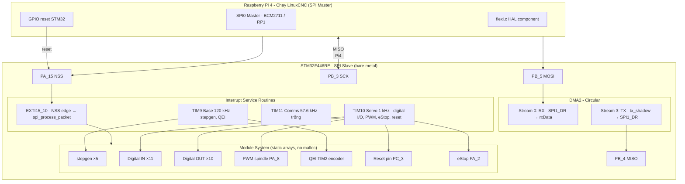

# STM32F446RE Bare-Metal Firmware + LinuxCNC Flexi-HAL

Hệ thống CNC thời gian thực: **Raspberry Pi 4 chạy LinuxCNC (SPI Master)** ↔ **STM32F446RE chạy firmware bare-metal (SPI Slave)**.

Giao tiếp qua SPI theo giao thức **Flexi** (64 bytes/gói). Firmware STM32 được viết lại từ Mbed OS (Remora-OS5) sang bare-metal C, phục vụ nghiên cứu học thuật.

---

## 1. Mô hình hệ thống



### Vai trò mỗi bên

| Thành phần | Vai trò | Nơi chạy |
|------------|---------|----------|
| **LinuxCNC + flexi.c** | Điều khiển CNC, tạo lệnh bước động, đọc phản hồi, quản lý HAL pins | Raspberry Pi 4 (SPI Master) |
| **STM32F446RE firmware** | Thực hiện stepgen, QEI, digital I/O, PWM, eStop, reset | STM32F446RE (SPI Slave, bare-metal) |

---

## 2. Cấu trúc repository

```
Firmware/MakefileFW/                          ← Firmware STM32 (SPI Slave)
├── README.md                                 ← Tài liệu này
├── Makefile                                  # Quy tắc biên dịch
├── STM32F446RE_FLASH.ld                      # Linker script: FLASH @ 0x08010000
├── startup_stm32f446xx.s                     # Vector table + Reset_Handler
├── inc/                                      # Header firmware
│   ├── configuration.h remora.h module.h gpio.h spi.h timer.h
│   ├── digitalpin.h pwm.h qei.h resetpin.h estop.h
│   ├── miniprintf.h usart.h config.h
├── src/                                      # Source firmware
│   ├── main.c spi.c timer.c module.c system_stm32f4xx.c
│   ├── stepgen.c digitalpin.c pwm.c qei.c resetpin.c estop.c
│   ├── usart.c config.c miniprintf.c
└── build/                                    # Build artifacts — không commit

linuxcnc/flexi/                               ← LinuxCNC HAL component (SPI Master)
├── flexi.c                                   # HAL component chính
├── flexi.h                                   # Hằng số, cấu trúc SPI, tên pins
├── bcm2835.c / bcm2835.h                     # Driver SPI/GPIO cho Pi 3/4
├── rp1lib.c / rp1lib.h                       # Driver RP1 cho Pi 5
├── gpiochip_rp1.c / gpiochip_rp1.h
├── spi-dw.c / spi-dw.h                       # Driver SPI DesignWare cho Pi 5
├── compileComp                               # Script biên dịch halcomponent
└── README (nếu có)
```

---

## 3. Khái niệm kỹ thuật cốt lõi (firmware STM32)

| Thành phần | Chi tiết |
|------------|----------|
| MCU | STM32F446RE, ARM Cortex-M4F, FPU single-precision |
| Clock | HSE 25 MHz XTAL → PLL → SYSCLK 168 MHz, AHB 168 MHz, APB1 42 MHz, APB2 84 MHz |
| Toolchain | arm-none-eabi-gcc 14.3.1, `-mcpu=cortex-m4 -mfloat-abi=hard -mfpu=fpv4-sp-d16` |
| Build flags | `-ffreestanding -nostdlib -std=gnu11 -Wall -Wextra` |
| Linker script | FLASH bắt đầu tại `0x08010000`, RAM tại `0x20000000` |
| SPI1 Slave | PA_15=NSS, PB_3=SCK, PB_4=MISO, PB_5=MOSI (AF5), Mode 0, SSM+SSI |
| DMA | DMA2 Stream3 TX (mem→peri, circular), Stream0 RX (peri→mem, circular) |
| EXTI | EXTI15_10 trên PA_15 (NSS rising edge), IRQ 40 |
| Timers | TIM9 Base 120 kHz (IRQ 24, prio 2), TIM10 Servo 1 kHz (IRQ 25, prio 3), TIM11 Comms 57.6 kHz (IRQ 26, prio 4), TIM2 QEI (IRQ 28) |
| Watchdog | IWDG ~2000 ms (LSI /64, reload 999), kick mỗi pass main loop |
| USART1 | PA_9=TX, PA_10=RX, AF7, 115200 baud |
| Flexi protocol | PRU_DATA / PRU_READ / PRU_WRITE / PRU_ESTOP, SPI_BUFF_SIZE=64, JOINTS=5, STEPBIT=22 |
| Module pattern | `struct Module` (update/updatePost/slowUpdate/configure/priv), mảng static, không malloc |

---

## 4. Các thread timer và module (firmware)

| Thread | Timer | Tần suất | IRQ | Ưu tiên NVIC | Module |
|--------|-------|----------|-----|--------------|--------|
| Base | TIM9 | 120 kHz | 24 | 2 | stepgen ×5, qei ×1 |
| Servo | TIM10 | 1 kHz | 25 | 3 | digitalpin DO ×10, DI ×11, pwm ×1, resetpin ×1, estop ×1 |
| Comms | TIM11 | 57.6 kHz | 26 | 4 | **(trống — chưa đăng ký module)** |
| QEI | TIM2 | poll | 28 | mặc định | (chỉ clear UIF, QEI poll trong Base) |

---

## 5. State machine (main.c, firmware)

```
ST_SETUP → ST_START → ST_IDLE → ST_RUNNING
              ↓           ↓           ↓
           (reset)     (reset)     (reset → ST_WDRESET)
                                          ↓
                                      ST_WDRESET (while(1), force watchdog reset)

ST_STOP → ST_IDLE (tự động quay lại IDLE)
```

---

## 6. SPI Flexi Protocol (64 bytes)

Cùng layout trên cả hai bên để LinuxCNC HAL component (`flexi.c`) và firmware STM32 trao đổi dữ liệu không cần chuyển đổi.

### rxData (Master → Slave, Pi4 → STM32)

| Offset | Trường | Kiểu | Mô tả |
|--------|--------|------|-------|
| 0–3 | `header` | int32_t | PRU_DATA / PRU_READ / PRU_WRITE / PRU_ESTOP |
| 4–23 | `jointFreqCmd[5]` | int32_t | Lệnh tần số step cho 5 joint |
| 24–27 | `setPoint[1]` | float | Set point (PWM spindle) |
| 28 | `jointEnable` | uint8_t | Bật/tắt joint |
| 29–30 | `outputs` | uint16_t | Digital outputs |
| 31 | `spare0` | uint8_t | Dự trữ |
| 32–63 | — | — | Dự trữ (0) |

### txData (Slave → Master, STM32 → Pi4)

| Offset | Trường | Kiểu | Mô tả |
|--------|--------|------|-------|
| 0–3 | `header` | int32_t | PRU_DATA / PRU_ESTOP |
| 4–23 | `jointFeedback[5]` | int32_t | Phản hồi vị step (DDS accumulator >> STEPBIT) |
| 24–27 | `processVariable[1]` | float | Biến quá trình (ví dụ vị trí QEI) |
| 28–29 | `inputs` | uint16_t | Digital inputs |
| 30–63 | — | — | Dự trữ (0) |

### Header Flexi (trong `flexi.h`)

| Header | Giá hex | Ý nghĩa |
|--------|---------|---------|
| PRU_DATA | `0x64617461` | "data" — phản hồi hợp lệ từ STM32 |
| PRU_READ | `0x72656164` | "read" — Pi4 yêu cầu đọc dữ liệu |
| PRU_WRITE | `0x77726974` | "writ" — Pi4 gửi lệnh xuống STM32 |
| PRU_ESTOP | `0x65737470` | "estp" — eStop active |

---

## 7. LinuxCNC HAL component (flexi.c) — Pi4

`flexi.c` là HAL component chạy trên Raspberry Pi 4, thực hiện vai trò **SPI Master**.

### Tính năng chính
- Khởi tạo SPI0 (Pi 3/4 qua BCM2835) hoặc RP1 SPI (Pi 5)
- Reset STM32 qua GPIO khi khởi động
- Chương trình chính chia thành 3 hàm realtime:
  - `update_freq()` — tính toán tần số step cho mỗi joint (position/velocity mode, P control + feed-forward)
  - `spi_write()` — gói lệnh (jointFreqCmd, jointEnable, setPoint, outputs) gửi xuống STM32 (header = PRU_WRITE)
  - `spi_read()` — đọc phản hồi từ STM32 (header = PRU_DATA), cập nhật feedback vị trí, inputs, processVariable
- Spike filter trên joint feedback (n=2 periods, M=250 magnitude) — giống firmware STM32
- Hỗ trợ eStop từ STM32 (header = PRU_ESTOP → SPIstatus = 0)

### Biên dịch trên Pi4

```bash
cd linuxcnc/flexi
./compileComp   # hoặc halcompile --install flexi.c
```

Yêu cầu: LinuxCNC đã cài (rtapi.h, hal.h), chạy với quyền root (truy cập /dev/mem hoặc /dev/gpiomem).

---

## 8. Hướng dẫn build firmware (STM32)

```bash
cd Firmware/MakefileFW

# Biên dịch đầy đủ
make

# Xem sử dụng bộ nhớ flash/RAM
make size

# Dọn dẹp artifacts
make clean

# Flash qua ST-Link (tùy chọn)
make flash
```

### Kết quả build (tham chiếu)

- `.text`: 8.564 bytes (FLASH)
- `.bss`: 3.300 bytes (RAM)
- 0 warning, 0 error với `-Wall -Wextra`

---

## 9. Các quy tắc lập trình (ràng buộc thiết kế)

1. **Không cấp phát động:** Không dùng `malloc`/`free`. Tất cả mảng module static, kích thước cố định (`MAX_MODULES_PER_THREAD = 32`).
2. **Không Mbed OS:** Chỉ dùng register access + định nghĩa kiểu CMSIS-style. Không include header mbed nào.
3. **`-ffreestanding -nostdlib`:** Cung cấp `_write`, `_exit` nếu cần.
4. **Bố trí SPI không thay đổi:** `rxData_t`/`txData_t` packed union giữ nguyên layout như Mbed `remora.h` để `flexi.c` hoạt động không đổi.
5. **ISR ngắn gọn:** Chỉ clear flag, chạy module, trả về. Không in printf trong ISR.
6. **Thanh ghi xác thực:** Địa chỉ thanh ghi theo STM32F446RE Reference Manual (RM0390), không đoán.

---

## 10. GPIO và peripherals (STM32)

| Chức năng | Pin | AF | Mô tả |
|-----------|-----|----|-------|
| SPI1 NSS | PA_15 | AF5 | NSS (SSM+SSI, EXTI15_10 edge detect) |
| SPI1 SCK | PB_3 | AF5 | Clock SPI |
| SPI1 MISO | PB_4 | AF5 | Slave → Master |
| SPI1 MOSI | PB_5 | AF5 | Master → Slave |
| USART1 TX | PA_9 | AF7 | Debug stdio 115200 baud |
| USART1 RX | PA_10 | AF7 | Debug stdio |
| PWM spindle | PA_8 | GPIO output | Software PWM, Servo thread |
| Reset pin | PC_3 | GPIO input | → g_pru_reset |
| eStop | PA_2 | GPIO input | → PRU_ESTOP header, g_pru_estop |
| QEI CH1 | PA_0 | TIM2_CH1 | Encoder A |
| QEI CH2 | PA_1 | TIM2_CH2 | Encoder B |

---

## 11. GPIO kết nối Pi4 ↔ STM32 (SPI0)

| Pi4 GPIO | STM32 Pin | Chức năng |
|----------|-----------|-----------|
| GPIO8 (CE0) | PA_15 (NSS) | Chip select SPI |
| GPIO11 (SCLK) | PB_3 (SCK) | Clock SPI |
| GPIO10 (MOSI) | PB_5 (MOSI) | Master → Slave |
| GPIO9 (MISO) | PB_4 (MISO) | Slave → Master |
| GPIO25 | PC_3 | Reset STM32 (tùy cấu hình) |
| GPIO17 | — | Reset STM32 (tham khảo flexi.c) |
| GPIO7 | — | Boot0 STM32 (tham khảo flexi.c) |

> Lưu ý: Mã số GPIO trên Pi có thể khác tùy phiên bản flexi.c. Xem `reset_gpio_pin`, `stm32_reset_gpio_pin`, `stm32_boot_gpio_pin` trong `flexi.c`.

---

## 12. Tài liệu liên quan

- `docs/architecture/` — Tài liệu thiết kế kiến trúc (Markdown + Draw.io XML): state machine, module registration, SPI communication, GPIO map, interrupt call tree, implementation status.
- `Firmware/FirmwareSource/Remora-OS5/` — Source gốc Mbed OS (tham chiếu, không sửa).
- `linuxcnc/flexi/` — HAL component LinuxCNC (SPI Master, chạy trên Pi4).

---

## 13. Trạng thái triển khai

- ✅ 24 chức năng firmware đã triển khai hoàn toàn (build sạch, 0 warning)
- ⚠️ 8 chức năng chưa hoàn thành / cần cải thiện (xem `docs/architecture/07-implementation-status.md`)
- Ưu tiên CAO: đăng ký module cho TIM11 Comms thread (`g_comms_modules` hiện trống)
- ✅ `flexi.c` (LinuxCNC HAL component) đã bao gồm trong repo

---

*Tài liệu này mô tả toàn bộ hệ thống LinuxCNC Flexi-HAL: Pi4 Master (flexi.c) + STM32F446RE Slave (bare-metal firmware). Viết bằng tiếng Việt, phục vụ nghiên cứu học thuật.*
